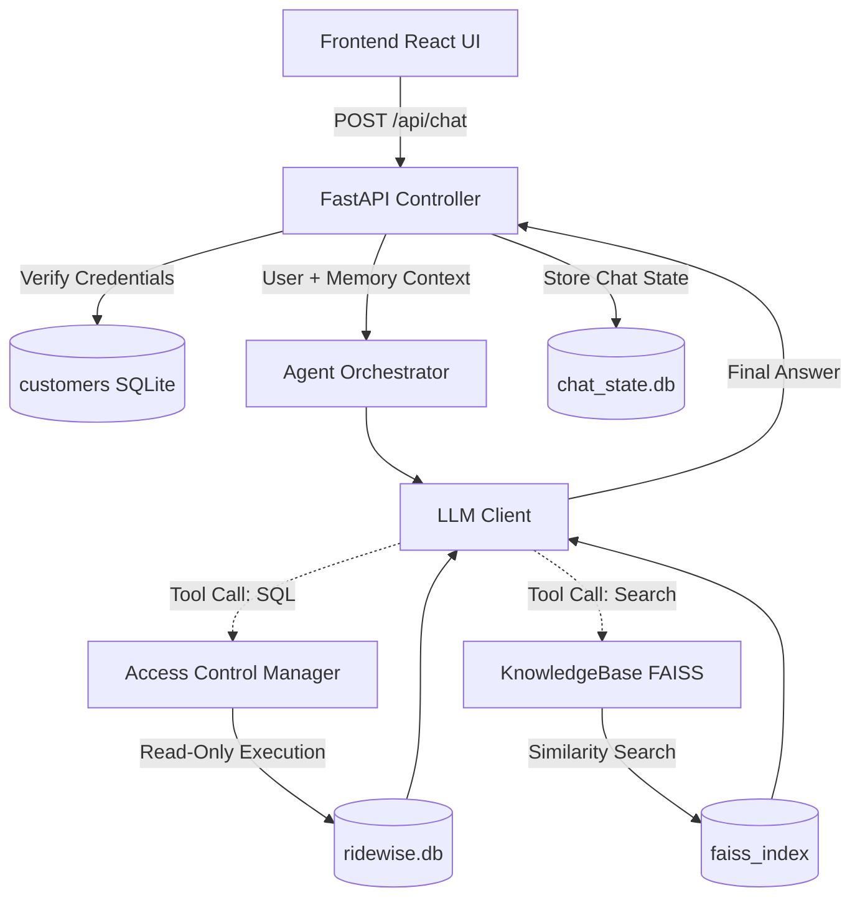

# RideWise Assist - AI Support Portal

RideWise Assist is a conversational AI agent designed for RideWise customers and support staff. It interfaces directly with RideWise's SQLite operational database and PDF rental policies using local FAISS retrieval. 

## 🏗 Architecture Overview



## 🚀 Setup & Run Instructions

This application is designed to be set up in under 10 minutes.

### 1. Configure Environment Variables
You must provide the NeoStats-hosted LLM credentials. Do not commit these to git.
```bash
cp backend_service/.env.example backend_service/.env
# Edit backend_service/.env and add your OPENAI_API_KEY and OPENAI_API_BASE
```

### 2. Start the Backend Server
Requires Python 3.10+.
```bash
cd backend_service
python3 -m venv venv
source venv/bin/activate
pip install -r requirements.txt
uvicorn app:app --host 0.0.0.0 --port 8001
```
*Note: On first boot, FAISS will parse and chunk the PDFs in `/data` into a local index. This may take 10-15 seconds.*

### 3. Start the Frontend Server
Requires Node.js.
```bash
cd frontend_app
npm install
npm run dev
```

### 4. Access the Application
Open your browser to the URL provided by Vite (usually `http://localhost:5173` or `http://localhost:3000`).

**Customer Mode:** Requires a valid `Customer ID` and `Mobile Number`. Here are some valid test credentials from the local database:

| Customer Name | Customer ID | Mobile Number |
|--------------|-------------|---------------|
| Aarav Sharma | `CUST0001`  | `9845012345`  |
| Priya Nair   | `CUST0002`  | `9886023456`  |
| Rohan Gowda  | `CUST0003`  | `9741034567`  |

**Support Agent Mode:** Password-less entry, but strictly enforces **in-chat 2FA** before executing operational SQL queries on behalf of users. When asked for data, the Agent LLM will demand the customer's mobile number in the chat prompt.

## 🔐 Security Features

1. **Hard UI Authentication**: Customers cannot access the chat interface without a valid matching ID and phone number.
2. **SQL AST Validation**: `AccessControlManager.py` physically parses all LLM-generated SQL, blocking `DROP`, `UPDATE`, `INSERT`, and enforcing `WHERE customer_id` for customers.
3. **In-Chat 2FA**: Support Agents must provide the customer's phone number in the chat to authorize data queries.
4. **Stateful UUID Sessions**: Memory is stored on the backend in `chat_state.db`, completely isolated from client tampering.
